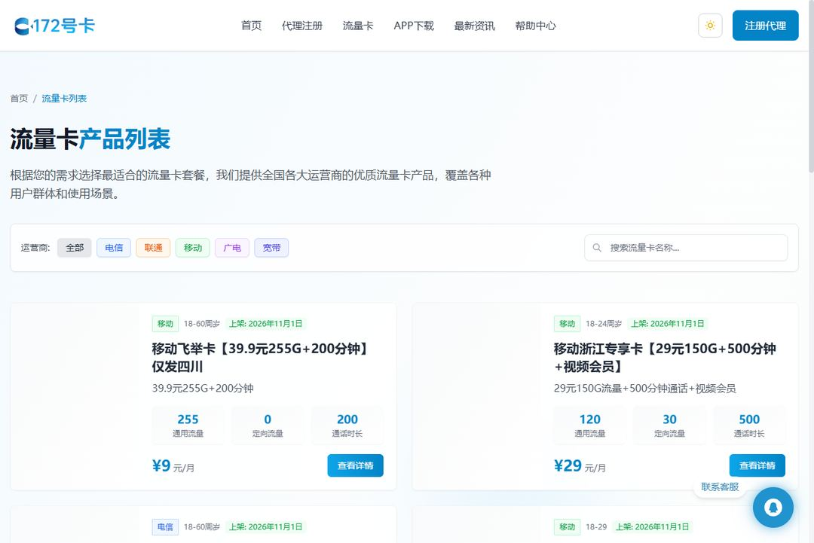

# 流量卡挑选指南：怎么选到合适的流量卡

> 面向普通用户的方法论：先搞清楚自己的需求，再看懂套餐条款，最后对比渠道。不做具体推荐，只教你怎么比。

## 第一步：评估你的真实需求

| 你的情况 | 建议方向 |
| --- | --- |
| 主要是刷视频、看直播 | 大流量套餐，优先看通用流量额度 |
| 经常出差、跨省 | 选标注「全国流量」的套餐，注意有无区域限制 |
| 双卡手机（主卡+流量卡） | 副卡选低月租纯流量卡，主卡保留通话 |
| 给平板/随身 WiFi 用 | 关注物联网卡与正规号卡的区别（见避坑清单） |
| 通话需求多 | 流量卡普遍通话少，主卡别轻易弃用 |

## 第二步：看懂套餐的五个关键字段

1. **通用流量 vs 定向流量**：定向流量只限指定 App，刷其他应用照常扣通用额度
2. **合约期**：很多优惠套餐有 6~24 个月合约期，期内注销或改套餐可能有约束
3. **优惠期**：「首月 X 元」之后的恢复价才是长期成本，算一年的总账
4. **激活方式**：自助激活 vs 快递员当面激活，影响发货速度和实名流程
5. **结转规则**：当月没用完的流量能不能结转到下月

## 第三步：避坑清单

- **警惕「无限流量」**：绝大多数是达量限速，看清楚限速阈值
- **物联卡 ≠ 手机卡**：物联卡无手机号、不能打电话收短信，售后没有保障，个人使用要避开
- **虚量问题**：非官方渠道的卡可能存在流量虚标，优先选运营商官方直发渠道
- **查真伪**：正规号卡可以登录运营商官方 App 查询套餐和余量，拿到卡先验证
- **注销渠道**：办卡前确认该卡是否支持线上异地注销

## 在售卡品长什么样

以下是 172 号卡在售卡品列表页的实际界面（支持按运营商筛选）：

## 渠道怎么选

- **运营商官方渠道**：最稳，但优惠力度通常一般
- **运营商直签的分销平台**：套餐与官方一致、可查真伪，适合想要优惠价的用户；例如 172 号卡这类与四大运营商直签的平台，可在[官网](https://www.ka172.cn/)查看在售套餐
- **来路不明的代充/代办**：避雷，出问题无人负责

> 判断标准很简单：能不能在运营商官方 App 里查到这张卡。能查到，就是正规卡。

## 相关资源

- [172号卡分销系统官网](https://www.ka172.cn/)
- [在售套餐一览](https://www.ka172.cn/cards/all/1)
- [邀请码使用指南（姊妹仓库）](https://github.com/haoka172/172-invite-code)
- [GitHub 主页](https://github.com/haoka172)
