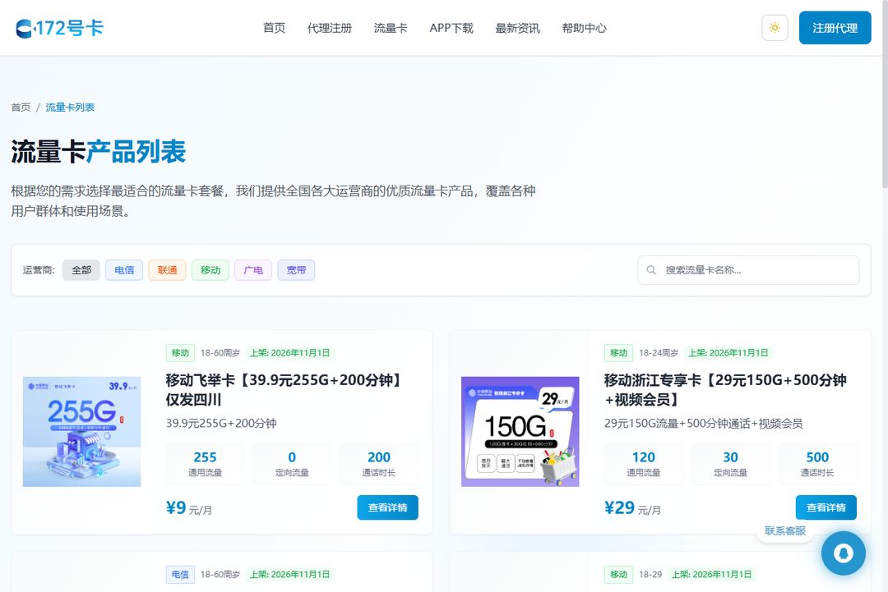
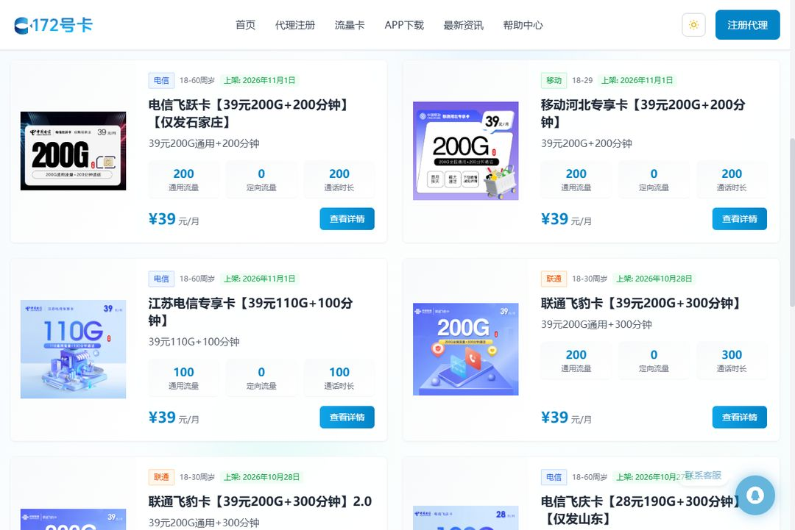

# 流量卡挑选指南：怎么选到合适的流量卡

  

> 面向普通用户的方法论：先搞清楚自己的需求，再看懂套餐条款，最后对比渠道。不做具体推荐，只教你怎么比。

## 第一步：评估你的真实需求

| 你的情况 | 建议方向 |
| --- | --- |
| 主要是刷视频、看直播 | 大流量套餐，优先看通用流量额度 |
| 经常出差、跨省 | 选标注「全国流量」的套餐，注意有无区域限制 |
| 双卡手机（主卡+流量卡） | 副卡选低月租纯流量卡，主卡保留通话 |
| 给平板/随身 WiFi 用 | 关注物联网卡与正规号卡的区别（见[避坑详解](docs/pitfalls.md)） |
| 通话需求多 | 流量卡普遍通话少，主卡别轻易弃用 |

## 第二步：看懂套餐的五个关键字段

拿到任何一张套餐页，按这五个字段逐项确认，信息不全的套餐直接放弃：

1. **通用流量 vs 定向流量**：定向流量只限指定 App，刷其他应用照常扣通用额度。比如下图的「移动飞举卡」标注 255G 通用 + 200 分钟通话，通用/定向/通话三个数字都摆在明面上，这种就是信息透明的套餐
2. **合约期**：很多优惠套餐有 6~24 个月合约期，期内注销或改套餐可能有约束
3. **优惠期**：「首月 X 元」之后的恢复价才是长期成本，算一年的总账
4. **激活方式**：自助激活 vs 快递员当面激活，影响发货速度和实名流程
5. **结转规则**：当月没用完的流量能不能结转到下月

## 第三步：避坑清单

五个最常见的坑，每个的详细判别方法见[避坑详解](docs/pitfalls.md)：

- **警惕「无限流量」**：绝大多数是达量限速，看清楚限速阈值
- **物联卡 ≠ 手机卡**：物联卡无手机号、不能打电话收短信，售后没有保障，个人使用要避开
- **虚量问题**：非官方渠道的卡可能存在流量虚标，优先选运营商官方直发渠道
- **查真伪**：正规号卡可以登录运营商官方 App 查询套餐和余量，拿到卡先验证
- **注销渠道**：办卡前确认该卡是否支持线上异地注销

## 第四步：按运营商选（差异速览)

| 运营商 | 信号特点 | 套餐倾向 | 适合人群 |
| --- | --- | --- | --- |
| 移动 | 城市与乡镇覆盖广 | 同档位价格略高 | 对信号稳定性要求高 |
| 电信 | 南方覆盖好、性价比高 | 大流量价格激进 | 流量需求大、预算敏感 |
| 联通 | 城市速度快 | 互联网套餐多 | 城市使用者 |
| 广电 | 共享移动 700M 频段 | 价格低、新业务多 | 预算优先、可接受新网络 |

各运营商的详细差异与选择逻辑见[四大运营商流量卡怎么选](docs/operators.md)。

## 第五步：用对比工作表做最终决定

把候选套餐填进[对比工作表](docs/compare-worksheet.md)，一张表比出优劣。

## 常见问题

**怎么判断流量卡是不是正规的？**
拿到卡后登录对应运营商的官方 App，能查到这张卡和套餐信息就是正规卡。查不到的一律不要用。

**19 元、29 元的大流量卡是真的吗？**
存在，但要看三个条件：优惠期后的恢复价、合约期长度、流量是通用还是定向。三项都透明的才算真划算。

**物联卡能当手机卡用吗？**
不建议。物联卡没有手机号码，不能通话收短信，流量由设备商转售，跑路风险高。

**在哪里能看到真实的在售套餐？**
正规分销平台会公示套餐详情（月租、流量构成、合约期）。例如 172 号卡的[在售卡品页](https://www.ka172.cn/cards/all/1)直接列出每张卡的通用流量/定向流量/通话时长，口径与运营商一致。

## 相关资源

- [172号卡分销系统官网](https://www.ka172.cn/)
- [在售套餐一览](https://www.ka172.cn/cards/all/1)
- [邀请码使用指南（姊妹仓库）](https://github.com/haoka172/172-invite-code)
- [GitHub 主页](https://github.com/haoka172)
